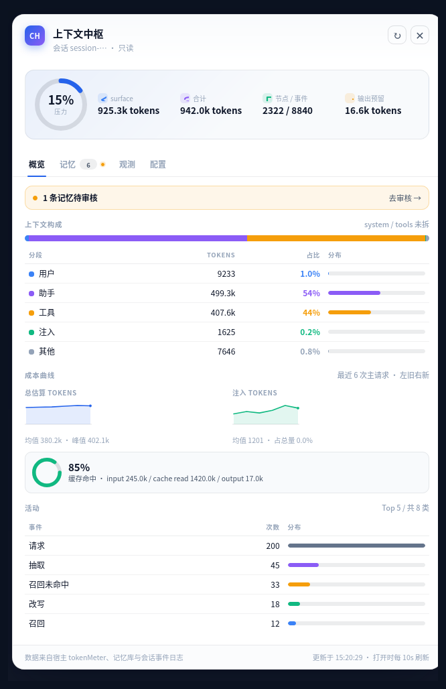

[Chinese](../../../README.md) · [English](../en/README.md) · **日本語** · [한국어](../ko/README.md) · [Deutsch](../de/README.md) · [Français](../fr/README.md) · [Español](../es/README.md)

# dsh-context-hub · コンテキストハブ

**圧縮・記憶・インサイト**を 1 つの DSH バンドルにまとめたプラグインです。導入手順は 1 回だけ、ホスト側のビルドは不要（純粋な ESM JavaScript）、データはローカルの SQLite に保存されます。

> ドキュメント索引：
> - [docs/spec.md](../../spec.md) — 機能仕様 v1.0（凍結済み）
> - [docs/design.md](../../design.md) — アーキテクチャ、データフロー、DSH 契約、障害モード
> - [docs/COMPATIBILITY.md](COMPATIBILITY.md) — 互換性マトリクス
> - [docs/PANEL-I18N.md](PANEL-I18N.md) — パネルの言語切替
> - 完全な説明は [英語版](../en/README.md) / [中国語版](../../../README.md) を参照

## なぜ 3 つではなく 1 つなのか

DSH ではこの 3 つは同じコンテキストパイプラインの 3 段階です。記憶は「新しいセッションに何を持ち込むか」、圧縮は「入りきらないときに何を捨て何を残すか」、インサイトは「上の 2 つが正しいかをどう確かめるか」を決めます。ストア・注入経路（`agent.inject()`）・検索入口を共有するため、3 つに分けると重複と衝突が増えるだけです。

## 機能

| 機能 | 実装 | 入口 |
| --- | --- | --- |
| 記憶 | `turn/end` で現在のモデルが構造化記憶を抽出し、5 次元の品質ゲートを通ったものだけ SQLite に保存 | 自動 + `context_hub_remember` |
| 検索（召回） | キーワード + FTS5 trigram のハイブリッド（同義語拡張・scope 重み・時間減衰）、任意でベクトル余弦を加算 | 自動 + `context_hub_search` |
| 検索品質 | `context_hub_probe` が top-k 命中率を測定、`context_hub_explain` が項目ごとのスコアを表示 | `context_hub_probe` / `context_hub_explain` |
| ガバナンス | session/project/global の階層、TTL アーカイブ、容量淘汰、競合 supersede | 自動 |
| 圧縮 | DSH ネイティブ圧縮を再利用。`compactor: hub` では `summarize()` をラップ（8 セクション、失敗時フォールバック） | `/context-hub compact` |
| 圧縮要約の記憶化 | `compaction/summary` を購読し `kind=summary` として保存、後から検索可能 | 自動 |
| 折りたたみ領域の検索・復元 | セッションログ全体を走査し、seq 範囲の原文を次のステップに再注入 | `context_hub_history` / `context_hub_restore` |
| メッセージ単位の展開 | `unfold`：次の N ステップだけ要約ノードを原文で置換（モデル要求のみ、ログは不変） | `context_hub_unfold` |
| 厳格な予算 | 1 回の注入に token 上限（既定 1200）と総期限（既定 4000ms）、超過時は注入しない | 自動 |
| インサイト | surface/合計 tokens、構成内訳、出力予約、水位、折りたたみ区間、直近リクエスト、記憶構成、コスト曲線 | `/context-hub status`、サイドバーバッジ + パネル |
| 監査 | 論理削除、明示的置換、監査チェーン、観測ログ、JSON エクスポート | `/context-hub audit/log/export` |
| 記憶の関係 | `memory_links`（related/supersedes）、検索時に 1 ホップ拡張（最大 1 件） | 自動 + `explain` |
| メッセージ索引 | `messages` + `messages_fts` を増分索引、記憶ゼロでも原文で検索可能 | 自動 |
| 審査フロー | `reviewPending=true` で低信頼の抽出を保留にし、承認/却下を手動で行う | `/context-hub review` |

## インストール

```bash
# npm（1.8.0 以降。embed 依存を含まない slim パッケージ）
# plugin_manager install_bundle(target="dsh-context-hub@1.8.0")

# 配布 tarball（embed/node_modules を含む。絶対パスの .tgz を指定）
# plugin_manager install_bundle(target="/absolute/path/dist/dsh-context-hub-<version>.tgz")
```

導入後は profile の `package.json` に依存とバンドル項目が追加され、`cordis.patch.yml` に `id: dsh-context-hub` が挿入されます。ソース変更後の再読み込み（再インストール不要）：

```
plugin_manager set_plugin(target="include:dsh-context-hub", enabled=true)
```

> 注意：`ctx.tools.register` の `parameters` / `output.schema` は標準 JSON Schema でなければなりません（オブジェクトは `required: [...]` 配列）。プロパティ単位の `required: true` は `defineTool` 専用の短縮形です。

## 検証済み

- **1.8.0**：P1/P2 の補強タスクをすべて完了（A1/A3/A4/B5/C4/C5/E4/A5/E3/E5/D4/D5）。5 つの新コマンド（export-jsonl/import-jsonl/graph/timeline/conflicts）、JSONL 入出力、記憶ビュー、互換性ドキュメント。
- **1.7.x**：パネルから native ⇄ hub を切替・永続化、失敗時 409。検索ステージの所要時間を記録し、`rerank.reasoningEffort=low` で 30% 削減。
- **1.6.6**：記憶 10 万件 + メッセージ 2 万件で rank p50 85.6ms / p95 99.8ms / p99 106.6ms、DB 67MB、RSS 249MB。
- **1.6.0**：注入の token 上限と期限、git プロジェクト識別（旧行の移行付き）、メッセージ単位 unfold。
- **1.5.3**：`multilingual-e5-small` で zh-holdout R@5 100%、英語 LongMemEval 12 問 83.3%。
- それ以前の履歴は[中国語版](../../../README.md)にあります。

## 使い方

```
/context-hub status                  # インサイト：コンテキスト圧迫 / 折りたたみ区間 / 記憶ストア
/context-hub doctor                  # 自己診断：FTS5/ベクトル/書き換え/再ランク
/context-hub search <キーワード>      # 長期記憶を検索
/context-hub remember <内容>          # 手動で 1 件記憶する
/context-hub history <キーワード>     # セッションログ全体（折りたたみ含む）を検索
/context-hub restore <開始seq> [終了seq]   # 折りたたみ原文を復元して注入（4000 文字）
/context-hub unfold [id:<n>|開始seq] [終了seq] [steps:<n>]
/context-hub explain <キーワード>     # 検索デバッグ：候補とスコア内訳
/context-hub probe [n]               # 命中率プローブ（既定 10）
/context-hub log [n]                 # 観測イベントのタイムライン
/context-hub audit <番号>             # 監査チェーン
/context-hub forget <番号>            # 論理削除
/context-hub supersede <番号> <新内容> # 明示的置換
/context-hub export                  # JSON エクスポート（0600）
/context-hub compact                 # 今すぐ圧縮
/context-hub compactor <hub|native>  # 圧縮器の切替
/context-hub reembed                 # 全ベクトル再計算
/context-hub watermark [on|off]      # 水位圧縮の切替（永続化）
/context-hub config [キー] [値]        # 予算・TTL・抽出・競合・意味検索の設定
/context-hub review [approve|reject] <番号>
/context-hub locale [auto|zh|en|ja|ko|de|fr|es]  # パネル/コマンドの言語
```

パネル：Web ページを更新すると、左サイドバー下部に「リング + コンテキスト率」のバッジが表示されます。クリックで 640px のカードが開き、固定 KPI ヘッダーの下に **概要**（構成バーと内訳表、コスト曲線、活動 Top5）、**記憶**（有効/保留/置換/アーカイブ/索引、範囲・種類のグラフ、最近使用、承認/却下）、**観測**（明細、活動全体、直近リクエストと検索レーン）、**設定**（予算・TTL・抽出、意味検索スイッチ、水位、圧縮器とモード、能力バッジ）、**言語** のタブがあります。Esc または背景クリックで閉じ、10 秒ごとに自動更新、配色は DSH テーマトークンに追従します。



データはホストのルート `/api/context-hub.status`（`connection` サービスが認証、未認証は 401）から取得します。水位の切替は `POST /api/context-hub.watermark`、書き込みは `POST /api/context-hub.review` と `POST /api/context-hub.action` です。

モデル側ツール：`context_hub_search` / `remember` / `history` / `restore` / `decompress` / `unfold` / `status` / `doctor`、および読み取り専用の `explain` / `log` / `probe` / `abtest`。

## 設定

既定値は `src/index.js` の `defaults` にあり、プラグイン config か環境変数で上書きできます。主な項目：

| 設定 | 既定 | 範囲 |
| --- | --- | --- |
| `recallMaxItems` | 8 | 1–20 |
| `recallMaxChars` | 1800 | 200–8000 |
| `recallMaxTokens` | 1200 | 100–4000（注入の token 上限） |
| `recallTimeoutMs` | 4000 | 0–20000（合計期限、超過時は注入しない） |
| `recallCooldownTurns` | 6 | 0–20 |
| `sessionTtlDays` / `projectTtlDays` / `globalTtlDays` | 7 / 90 / 0 | 3·7·15·30 / 0–3650 / 0–3650 |
| `capacityPerScope` | 5000 | 100–100000 |
| `extractPassesPerTurn` | 2 | 1–10 |
| `admissionThreshold` | 0.6 | 0–1 |
| `conflictPolicy` | `evidence` | `evidence` / `recency` |
| `compactor` | `native` | `native` / `hub` |
| `mode` | `auto` | `auto` / `observe` / `assist` / `takeover` / `full` |
| `reviewPending` | false | 低信頼の抽出を保留にする |
| `embedding.enabled` / `baseUrl` / `model` | false / 空 / 空 | OpenAI 互換エンドポイント |
| `embedding.fusion` | `weighted` | `weighted` / `rrf` |
| `rewrite.enabled` | false | クエリ書き換え（失敗時フォールバック） |
| `rerank.enabled` | false | LLM 再ランク |
| `watermark.enabled` / `triggerRatio` / `retainTokens` | false / 0.7 / 20000 | 水位圧縮 |
| `unfold.steps` / `maxChars` | 3 / 8000 | 展開の予算 |

全項目の一覧は[英語版](../en/README.md#configuration)にあります。インストール済み項目は `cordis.patch.yml` に `config:` を追加して設定します（`insert:` は初回導入のみ）。

```yaml
- id: dsh-context-hub
  config:
    compactor: hub
    embedding:
      enabled: true
      baseUrl: https://api.example.com/v1
      model: text-embedding-3-small
      apiKeyEnv: MY_EMBED_KEY
```

### ローカル埋め込みサービス（同梱）

記憶テキストを外部 API に送りたくない場合は、同梱の `embed/`（transformers.js + ONNX CPU、OpenAI 互換）を使います。リポジトリには `embed/node_modules/`（約 475MB）が含まれるため clone 後は追加インストール不要です。npm パッケージ（依存なし）だけは次が必要です。

```bash
cd embed && npm install --ignore-scripts
./start.sh                        # 手動起動：127.0.0.1:11434
curl -s localhost:11434/health    # {"ok":true,...,"ready":true}
```

`embedding.baseUrl` がループバックで `embedding.autoStart` が真なら、プラグインが自動で起動し `/health` をポーリングしてからベクトルを埋めます。失敗しても劣化のみで会話は止まりません。モデルは `embed/.cache/Xenova/<model>/` に配置され、初回にダウンロードされます（オフライン用に Release の `dsh-context-hub-models-e5-q8.tar.gz` も利用可能）。

## 配布とリリース

- `package.json` の `files` は `src` / `client` / `cordis.patch.yml` / `locale` / `icon.svg` / `README.md` / `LICENSE` / `CHANGELOG.md` / `docs` / `scripts` / `test-smoke.mjs` / `embed/` を含みます。
- 表示メタデータ：`locale/en.json` と `locale/zh.json` の `meta.title` / `meta.description`、`icon.svg`（610B）。
- パッケージングは 2 種類：`npm pack`（slim、`embed/node_modules` を含まない）と `scripts/pack.sh`（`git archive`、vendored 依存を含む約 157MB）。
- 2026-11-27 時点：**npm 1.8.0 を公開済み**（public、slim 約 280kB）。
- 配布物：`dist/dsh-context-hub-*.tgz`（版・ファイル数・バイト数・SHA-256 は生成時の `dist/INSTALL.md` が正）。

## データ

- 既定パス：`$DSH_HOME/context-hub/memory.db`（`DSH_HOME` 未設定時は `~/.dsh`）。
- 上書き：環境変数 `DSH_CONTEXT_HUB_DB=/path/to/memory.db`。
- 記憶は**派生キャッシュ**です。セッションログが唯一の真実であり、DB の破損・削除で会話が止まることはありません。

## 設計上の境界（現行版）

- 既定ではネイティブ圧縮を置き換えません。`compactor: native` では `compaction-basic` が圧縮を担当し、本プラグインはトリガと検索の補完のみ。`compactor: hub` では `summarize()` をラップします（サービス再登録なし、失敗時フォールバック）。
- パネルはガバナンス・スイッチ・予算パラメータのみ書き込み、記憶内容の編集は行いません。コンテキストは読み取り専用で、セッションに書き戻しません。
- 独自のセッションイベント型は追加せず、既存の `user/message` と `turn/end` のみで動作します。
- 検索はキーワード重なり + FTS5 trigram に、任意でベクトル余弦と LLM クエリ書き換えを加算します。どれかが使えなくても自動で劣化し、主経路には影響しません。
- 水位圧縮は既定で無効です。`watermark.enabled: true` のとき、pre-step で `triggerRatio` と `retainTokens`/`retainTurns` に従って最古の前置のみを折りたたみます。
- 抽出の失敗は `logger.warn` のみで、会話をブロックしません。

## ロードマップ

- **1.8.0**：12 の P1/P2 補強（決定的書き込み、競合分類、段階的審査、クエリ衛生、圧縮レシート、要約品質ループ、正直な指標、近傍重複排除、記憶ビュー、JSONL 入出力、互換性ドキュメント、可搬性）。
- **1.7.x**：グラフ 1 ホップ、圧縮台帳、パネルの圧縮器切替、性能改善。
- **1.6.x**：注入の上限と期限、git 識別、メッセージ単位 unfold、vendored 配布。
- **1.5.x**：パネル再構築（KPI ヘッダー + 4 タブ）、メッセージ索引、多言語 embedder、水位 retainTurns。
- 以後：英語の意味検索の強化、水位の既定動作の検討、パネルの locale 連携。

未対応：意味検索の英語精度（LongMemEval R@5 83.3%）、水位の大区間折りたたみ承認フロー、docs のうち design/spec/comparison は中国語のみです。
